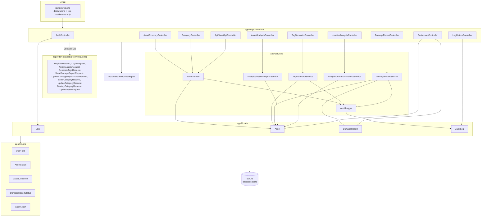
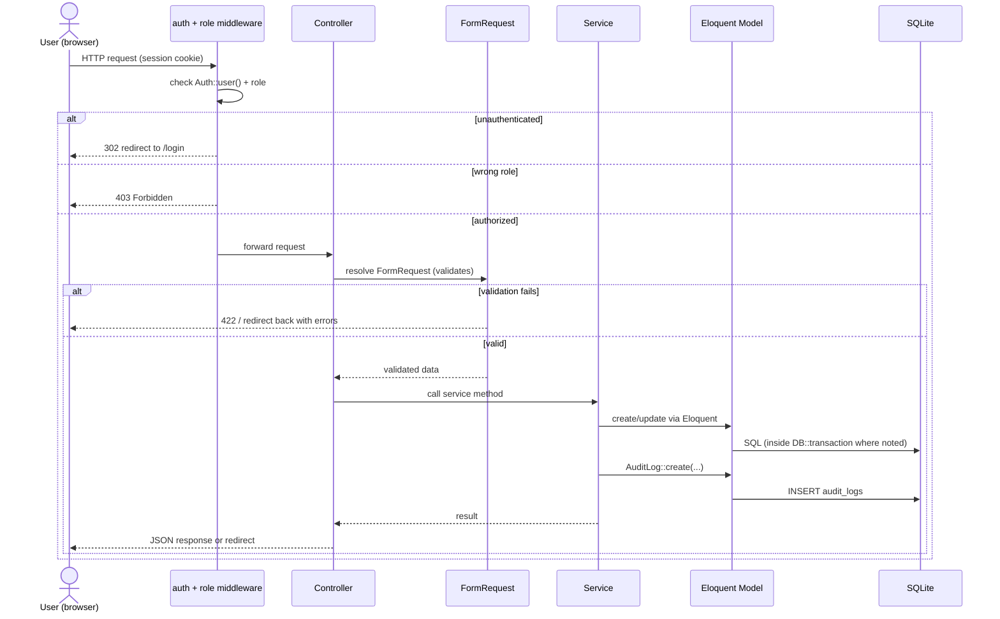

# Architecture

## Stack

| Layer | Technology |
|---|---|
| Backend framework | Laravel 12 (PHP 8.2) |
| Database | SQLite (`database/database.sqlite`) |
| Frontend build | Vite 7, Tailwind CSS v4 |
| Frontend runtime | Server-rendered Blade + vanilla JS (`fetch`), no SPA framework |
| Auth | Laravel session-based guard (`config/auth.php`, driver `web`) |
| Testing | PHPUnit 11 via `php artisan test`, `RefreshDatabase` trait |
| Formatting | Laravel Pint |

There is no API layer for external consumers — the `api/` prefixed routes
in `routes/web.php` are same-origin JSON endpoints consumed by the
Blade views' own JavaScript (fetch calls with session cookies), not a
public API.

## Layered structure

The codebase follows a conventional Laravel layering: routes declare
endpoints only, controllers translate HTTP into service calls, services hold
business rules, models are thin data carriers with enum-cast vocabulary.



## Request lifecycle (typical write operation)



## Directory map (application code only)

```
app/
  Enums/                 UserRole, AssetStatus, AssetCondition,
                         DamageReportStatus, AuditAction
  Http/
    Controllers/         AuthController, DashboardController,
                         AssetDirectoryController, CategoryController,
                         AssetAnalysisController, LocationAnalysisController,
                         DamageReportController, LogHistoryController,
                         TagGeneratorController
    Controllers/Api/     AssetApiController
    Middleware/          EnsureUserHasRole (alias: role)
    Requests/            one FormRequest per write endpoint
  Models/                User, Asset, DamageReport, AuditLog
  Services/              AssetService, TagGeneratorService,
                         DamageReportService, AuditLogger
  Services/Analytics/    AssetAnalyticsService, LocationAnalyticsService
  Providers/             AppServiceProvider (model strictness guardrails)
routes/
  web.php                all HTTP routes, role-gated
  console.php            Artisan commands only
database/
  migrations/            6 files (3 framework defaults + assets,
                         damage_reports, audit_logs)
  factories/             UserFactory, AssetFactory
  seeders/                DatabaseSeeder (2 seeded accounts)
resources/
  views/                 10 Blade views (login, register, staff_dashboard,
                         asset_dashboard, asset_directory, asset_analysis,
                         location_analysis, damage_queue, log_history,
                         welcome)
  css/, js/              per-page stylesheets, Vite entry + Axios bootstrap
tests/
  Feature/               AuthTest, DamageReportTest, TagGeneratorTest,
                         AssetDirectoryTest, AnalyticsTest, RouteSmokeTest
```

## Authorization model

`App\Http\Middleware\EnsureUserHasRole` (alias `role`) is applied per-route
in `routes/web.php`, not globally. It accepts one or more role strings and
403s any authenticated user whose `role` enum value isn't in the allowed
set; an unauthenticated request is redirected to `/login` by the standard
`auth` middleware before it ever reaches the role check.

| Route group | Middleware | Roles allowed |
|---|---|---|
| `/staff_dashboard` | `auth`, `role:staff` | Staff only |
| `/damage-queue/report` (submit) | `auth` | Staff and Asset Team |
| `/api/assets/tracking/{trackingNumber}` | `auth` | Staff and Asset Team |
| `/dashboard`, `/assets`, `/analysis/*`, `/logs`, `/damage-queue` (view/manage), `/categories/*`, `/tags/*`, `/api/assets/by-type`, `/api/assets/{asset}` | `auth`, `role:asset_team` | Asset Team only |
| `/login`, `/register` (both verbs) | none | Guests |

This table is enforced in `tests/Feature/RouteSmokeTest.php`, which asserts
every Asset-Team route 200s for an Asset Team account and 403s for a Staff
account, and that `/staff_dashboard` is forbidden to Asset Team.
