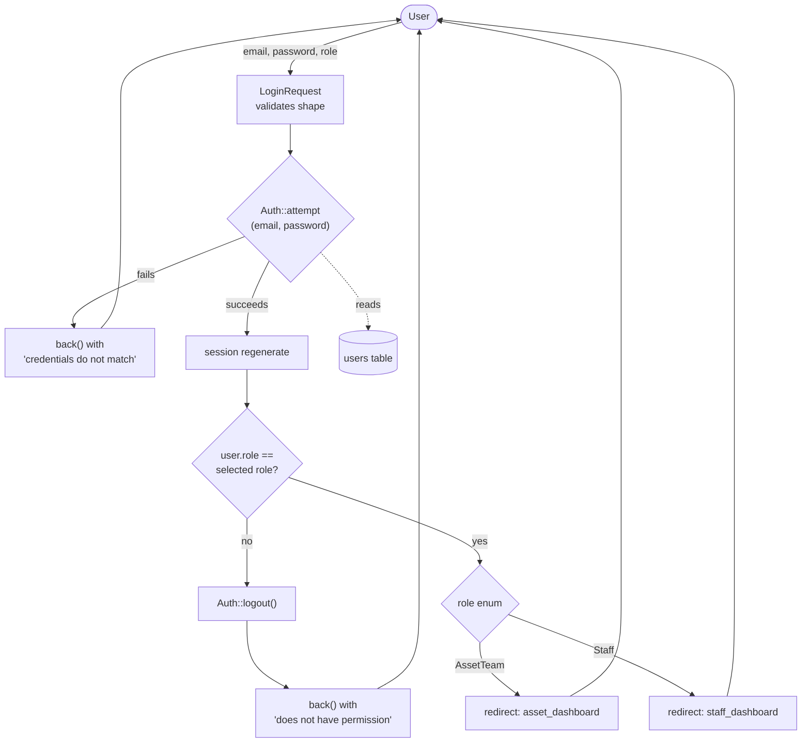
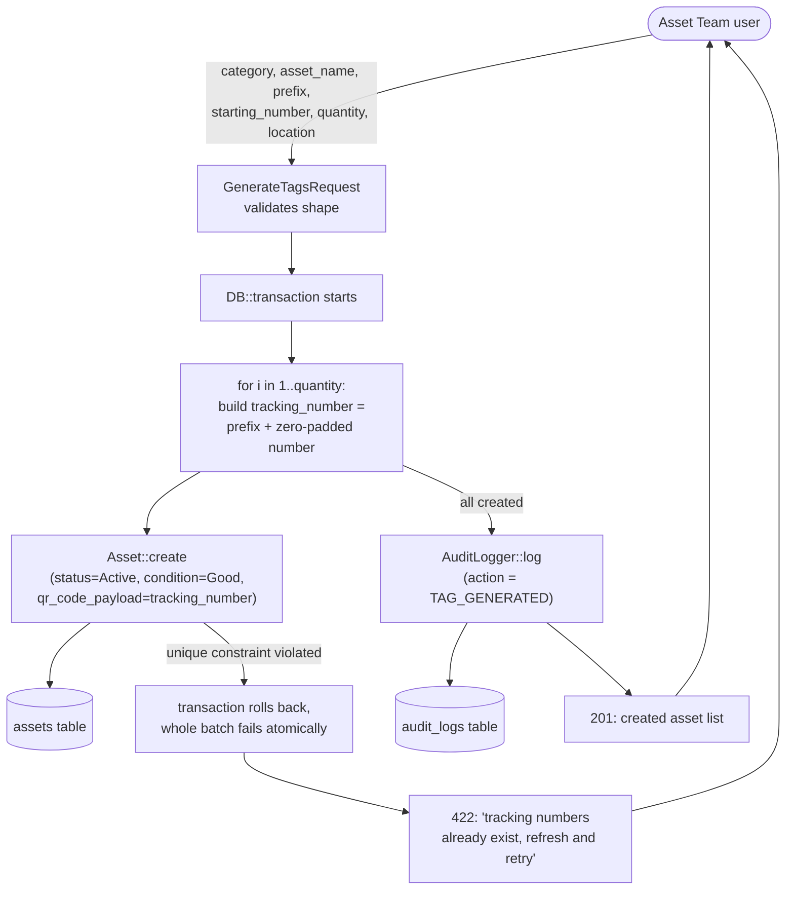
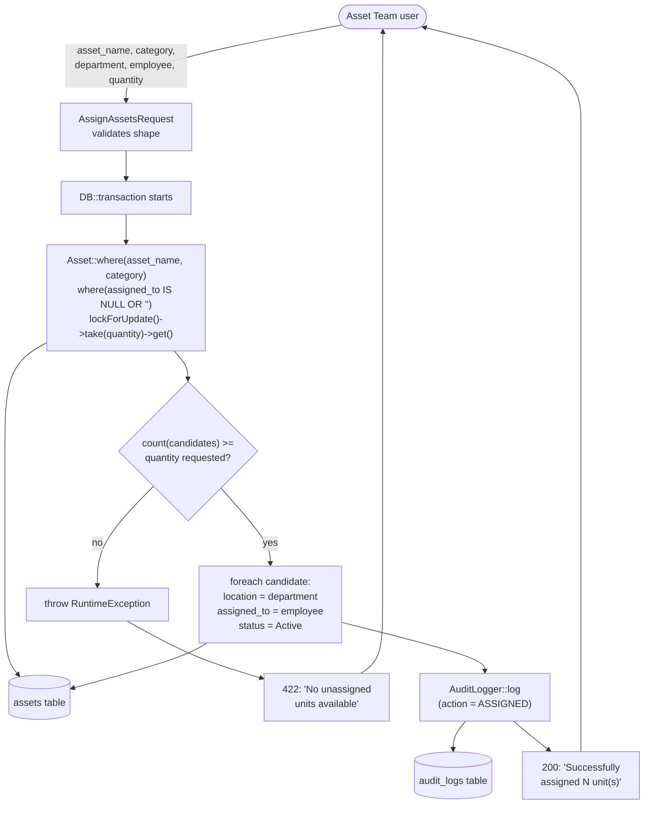
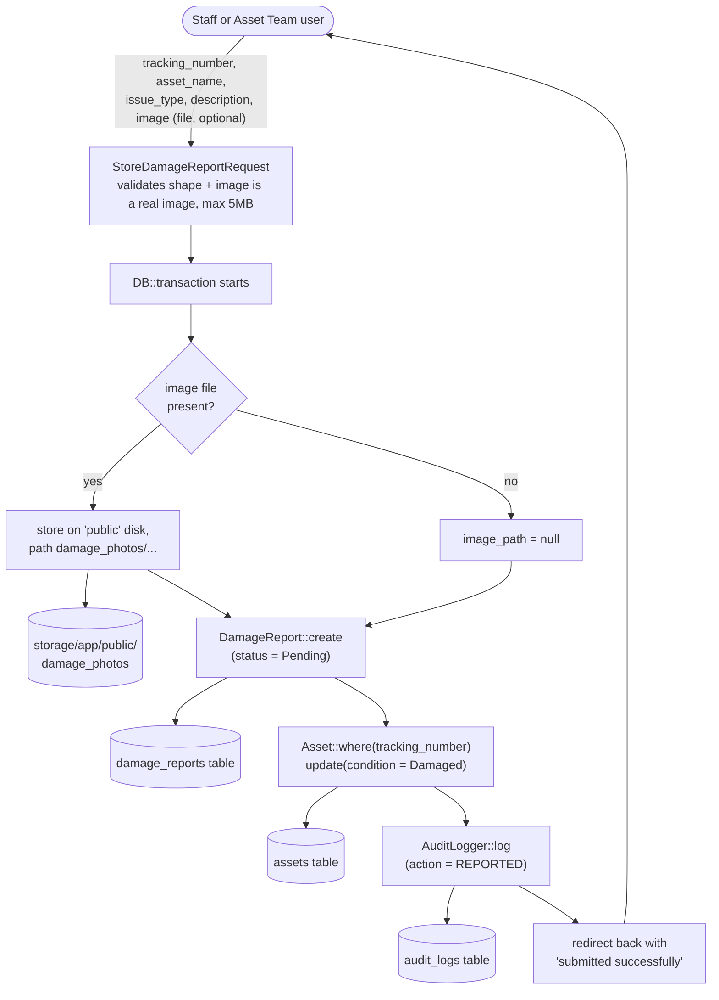

# Data Flow Diagrams

Mermaid has no native DFD notation, so these use flowchart conventions:
rounded rectangles = external entities, rectangles = processes, cylinders =
data stores. Each diagram traces one real code path — file and method names
are named inline so any step can be checked against source.

## 1. Authentication (login)

Traced from `App\Http\Controllers\AuthController::login()`.

## 2. Tag generation (bulk)

Traced from `App\Http\Controllers\TagGeneratorController::storeBulkTags()`
→ `App\Services\TagGeneratorService::storeBulk()`.

Note: the batch is **not** re-checked for the next available number inside
the transaction — the client is expected to have called
`GET /tags/next-number` first. A collision (two Asset Team members
generating tags for the same prefix at the same instant) fails the whole
batch via the `tracking_number` unique constraint rather than silently
drifting numbers, which is a deliberate trade-off, not an oversight.

## 3. Asset assignment

Traced from `App\Http\Controllers\AssetDirectoryController::assign()`
→ `App\Services\AssetService::assign()`.

`lockForUpdate()` is a no-op on SQLite (no row-level locking support), but
the whole read-then-update sequence still runs inside one
`DB::transaction()`, which is the actual correctness fix versus the prior
closure-based implementation that had no transaction boundary at all and
could double-assign the same units under concurrent requests.

## 4. Damage report submission

Traced from `App\Http\Controllers\DamageReportController::store()`
→ `App\Services\DamageReportService::submit()`.

This is the flow that was completely broken before the 2026-09-15
remediation: the previous implementation wrote to a table
(`activity_logs`) and a column (`image`) that never existed in the schema,
so every submission threw inside the transaction and rolled back silently
from the user's point of view. The current flow is covered end-to-end by
`tests/Feature/DamageReportTest::test_staff_can_submit_a_damage_report_with_a_photo`.
