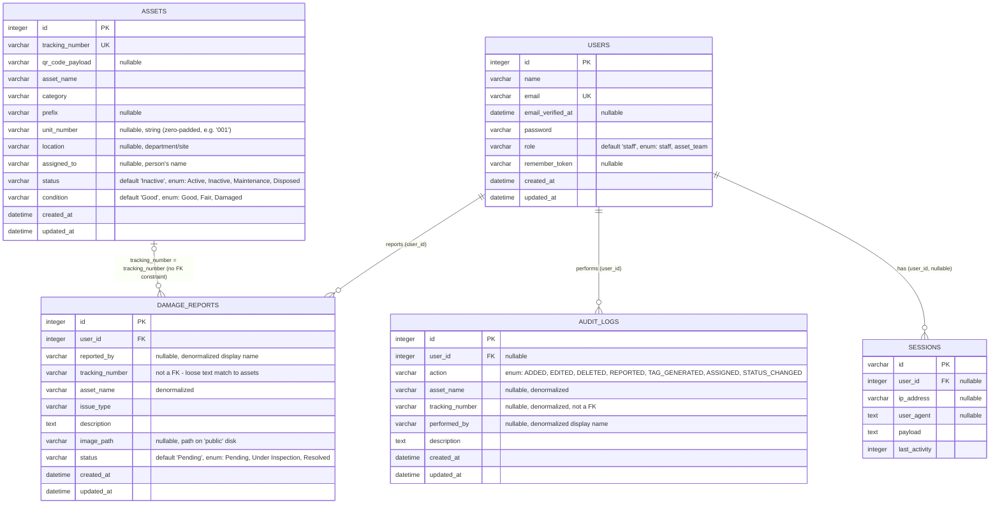

# Entity-Relationship Diagram

Generated directly from `sqlite3 database/database.sqlite ".schema <table>"`
against the live database file (not the migration source, which confirms
the migrations actually ran as written). Framework infrastructure tables
(`cache`, `cache_locks`, `jobs`, `job_batches`, `failed_jobs`,
`password_reset_tokens`) are listed for completeness but omitted from the
relationship diagram since they carry no foreign keys into the domain.

## Notes grounded in the actual schema

- **`assets.tracking_number` is the only link between `assets` and
  `damage_reports`/`audit_logs`, and it is not a database-level foreign
  key.** It's a plain string match, populated at write time by each
  service (`DamageReportService`, `AuditLogger`). `Asset::damageReports()`
  models this in Eloquent as `hasMany(DamageReport::class,
  'tracking_number', 'tracking_number')`, but nothing in the schema
  prevents a `damage_reports` row from referencing a `tracking_number`
  that no longer exists in `assets` (e.g. after an asset is deleted via
  `DELETE /api/assets/{asset}`).
- **`damage_reports.user_id` and `audit_logs.user_id` both cascade-delete**
  (`on delete cascade`) — deleting a `User` row deletes their damage
  reports and audit log entries. `audit_logs.user_id` is nullable, so a
  system-generated log with no actor is representable, but nothing in the
  current codebase creates one (every `AuditLogger::log()` call requires a
  `User` argument).
- **`location` and `assigned_to` are deliberately separate columns.** An
  earlier version of this schema encoded both in the single `location`
  field as `"Department - Person"` and parsed it with `explode('-')` at
  read time; that was removed during the 2026-09-15 remediation in favor
  of two real columns.
- **`unit_number` is a string, not an integer**, despite holding numeric
  values — it stores zero-padded values like `"001"` where the leading
  zero is semantically significant (it is concatenated into
  `tracking_number` and `qr_code_payload`, not used arithmetically).
- **Enum columns are plain `varchar` at the SQL level.** SQLite has no
  native enum type; the fixed vocabulary (`Active`/`Inactive`/...,
  `Good`/`Fair`/`Damaged`, etc.) is enforced at the PHP layer only, via
  `App\Enums\*` backed enums cast on the Eloquent models
  (`App\Models\Asset`, `DamageReport`, `AuditLog`, `User`) and via
  `Illuminate\Validation\Rules\Enum` in the FormRequests. A row inserted
  by raw SQL outside the application would not be constrained to these
  values.
