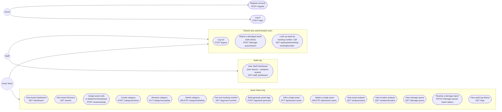

# Use Case Diagram

Mermaid has no native UML use-case shape, so actors connect to stadium
(`([ ])`) nodes representing each use case. Every use case below maps to a
real route in `routes/web.php`; there is no use case here that isn't backed
by a working controller action and (per `tests/Feature/`) a passing test.

Guest-only use cases (Register, Log in) are outside both role subgraphs
since they exist before a role is established.

## Notes grounded in the code, not assumption

- **Both roles can submit a damage report.** `report_damage.store` sits
  under plain `auth` middleware (no `role:` gate) because both
  `staff_dashboard.blade.php` and `damage_queue.blade.php` contain a submit
  form pointing at the same route — Staff self-reports on their own
  equipment, Asset Team can log a report on someone else's behalf from the
  management page.
- **The tracking-number lookup API is shared** for the same reason: it
  backs the QR scanner embedded in both the staff dashboard and the asset
  directory.
- **"Resolve" is the only status transition wired to the UI.** The
  `DamageReportStatus` enum defines `Pending`, `Under Inspection`, and
  `Resolved`, but `damage_queue.blade.php` only ever sends `Resolved` — the
  "Under Inspection" state exists in code but has no UI trigger. This is
  documented, not silently assumed to be reachable.
- **No use case exists for editing your own profile, password reset, or
  admin user management.** These are absent from `routes/web.php` entirely
  — not hidden behind a role, simply not built.
